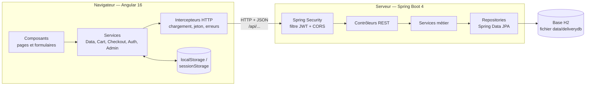
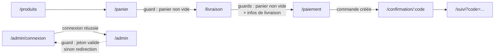
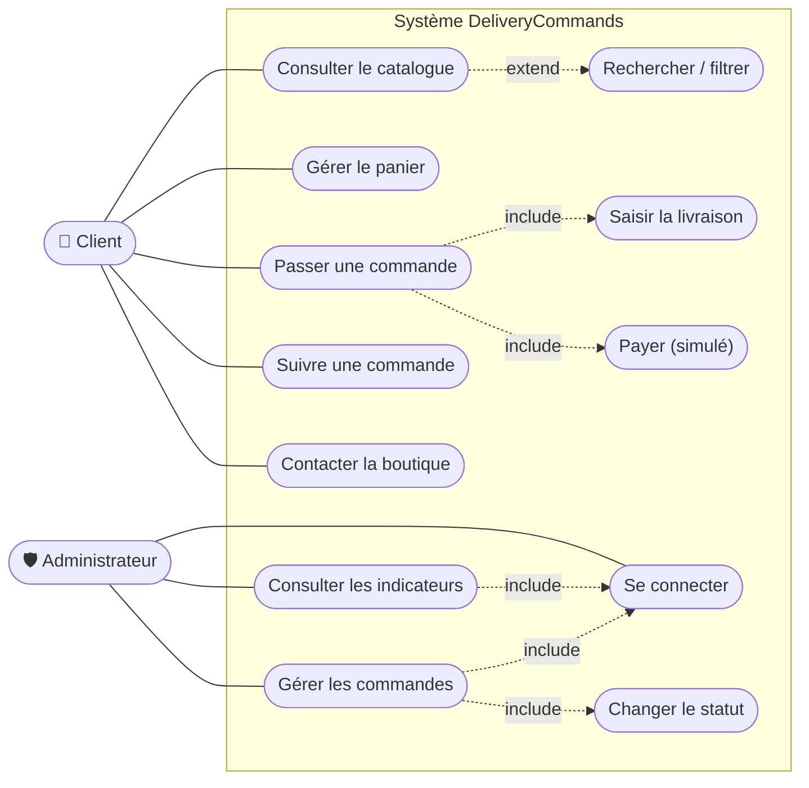
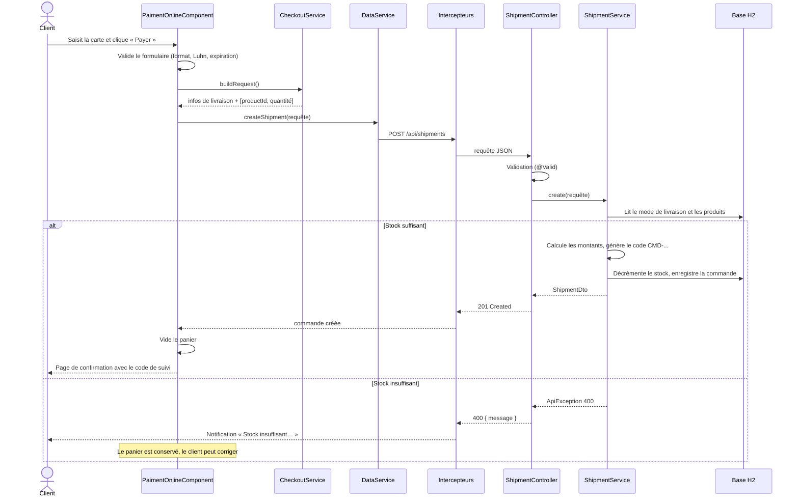
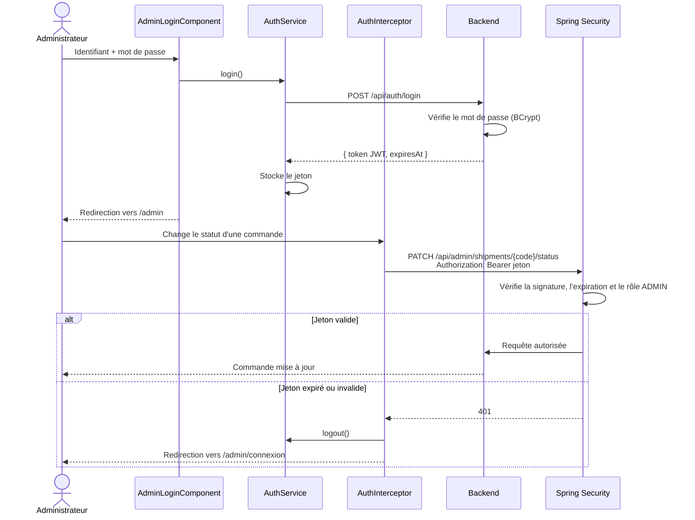
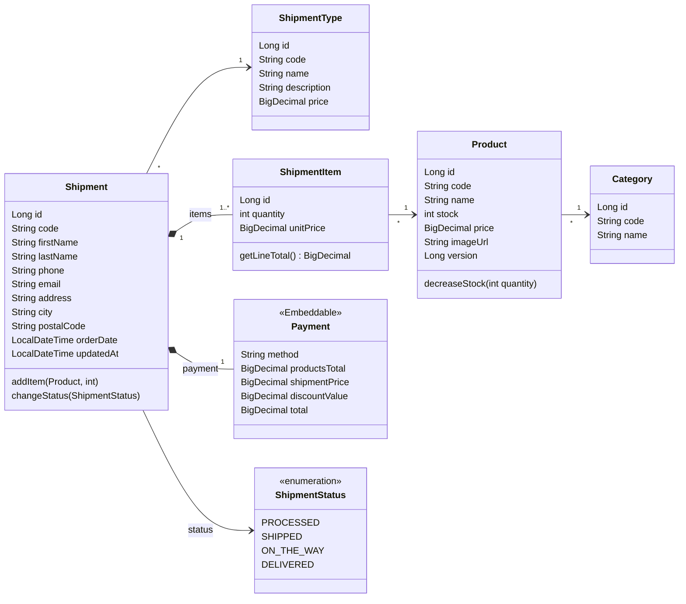

# DeliveryCommands — Documentation du projet

> Boutique en ligne avec suivi de livraison.
> Frontend **Angular 16** · Backend **Spring Boot 4 / Java 17** · Base **H2**

## Sommaire

- [A. Présentation générale](#a-présentation-générale)
- [B. Description fonctionnelle](#b-description-fonctionnelle)
- [C. Architecture technique](#c-architecture-technique)
- [D. Technologies utilisées](#d-technologies-utilisées)
- [E. Guide d'installation](#e-guide-dinstallation)
- [Annexe 1 — Référence de l'API REST](#annexe-1--référence-de-lapi-rest)
- [Annexe 2 — Évolutions apportées](#annexe-2--évolutions-apportées)

---

## A. Présentation générale

### Nom du projet
**DeliveryCommands** : application web de commande en ligne et de suivi de livraison.

### Contexte
Les petits commerçants marocains vendent de plus en plus en ligne, mais n'ont souvent ni site marchand
ni outil pour suivre les livraisons. Leurs clients, eux, veulent savoir à tout moment où en est leur colis,
sans devoir appeler la boutique.

### Problématique
> Comment permettre à une boutique de vendre en ligne et à ses clients de suivre leur commande,
> **de façon simple, fiable et sécurisée**, sans exposer les données personnelles des clients ?

Cette question recouvre plusieurs difficultés concrètes :
- les prix et le stock doivent rester justes, même si quelqu'un modifie les données dans son navigateur ;
- le client doit pouvoir suivre sa commande **sans compte**, mais personne d'autre ne doit voir ses informations ;
- le commerçant doit pouvoir gérer les commandes depuis un espace réservé.

### Objectifs
1. Proposer un **catalogue** consultable avec recherche et filtre par catégorie.
2. Offrir un **tunnel de commande** complet : panier → livraison → paiement → confirmation.
3. Permettre le **suivi de commande** par code de suivi et e-mail.
4. Fournir un **espace administrateur** sécurisé pour suivre l'activité et faire avancer les commandes.
5. Garantir la **fiabilité** : calculs côté serveur, validation des données, tests automatisés.

### Solution proposée
Une application web en deux parties qui communiquent par une API REST (JSON) :
- un **frontend Angular** (ce que voit l'utilisateur dans son navigateur) ;
- un **backend Spring Boot** (règles métier, sécurité, base de données).

### Public cible
| Acteur | Besoin |
|---|---|
| **Client** (visiteur) | Acheter des produits et suivre sa livraison, sans créer de compte |
| **Administrateur** (commerçant) | Voir les commandes, changer leur statut, surveiller le chiffre d'affaires et le stock |

### Besoins fonctionnels
| # | Le système doit permettre… | Acteur |
|---|---|---|
| BF1 | de consulter le catalogue, rechercher un produit et filtrer par catégorie | Client |
| BF2 | de gérer un panier (ajouter, modifier la quantité, retirer) | Client |
| BF3 | de saisir ses informations et choisir un mode de livraison | Client |
| BF4 | de payer sa commande (paiement **simulé**) et d'obtenir un code de suivi | Client |
| BF5 | de suivre une commande avec son code et son e-mail | Client |
| BF6 | de contacter la boutique | Client |
| BF7 | de se connecter à un espace réservé | Administrateur |
| BF8 | de consulter les indicateurs (commandes, chiffre d'affaires, stock faible) | Administrateur |
| BF9 | de lister, filtrer, rechercher les commandes et changer leur statut | Administrateur |

### Besoins non fonctionnels
| Catégorie | Exigence | Comment elle est satisfaite |
|---|---|---|
| **Sécurité** | Prix et stock non falsifiables | Le serveur recalcule tous les montants ; le navigateur n'envoie que des identifiants et quantités |
| **Sécurité** | Espace admin protégé | Jeton JWT signé (HS256), valable 2 h ; mots de passe hachés avec BCrypt |
| **Confidentialité** | Ne pas exposer les données des clients | Suivi exigeant code **et** e-mail ; réponse sans téléphone, e-mail ni adresse |
| **Fiabilité** | Pas de vente au-delà du stock | Vérification du stock + transaction + verrouillage optimiste (`@Version`) |
| **Ergonomie** | Interface claire, en français | Messages d'erreur sous chaque champ, notifications, formats français (« 1 238,00 MAD ») |
| **Accessibilité / responsive** | Utilisable sur mobile | Grille Bootstrap, menu repliable, libellés pour lecteurs d'écran |
| **Performance** | Chargement rapide | Bundle de production : 832 Ko (≈ 178 Ko compressés), images chargées à la demande |
| **Maintenabilité** | Code testable et organisé | Architecture en couches, 51 tests frontend + 8 tests d'intégration backend |
| **Portabilité** | Installation simple | Base H2 embarquée (aucun serveur de base de données à installer), Maven Wrapper fourni |

---

## B. Description fonctionnelle

### B.1 Catalogue de produits
| | |
|---|---|
| **Objectif** | Présenter les produits disponibles à la vente |
| **Utilisateurs** | Client |
| **Fonctionnement** | Au chargement, la page appelle `GET /api/products` et `GET /api/categories`. La recherche (par nom) et le filtre (par catégorie) s'appliquent **instantanément dans le navigateur**, sans nouvel appel au serveur. Chaque carte affiche le prix, la catégorie et le stock ; un produit en rupture ne peut pas être ajouté. Un indicateur de chargement et un message « Réessayer » gèrent les cas de lenteur ou de panne. |
| **Étapes** | 1. Ouvrir « Boutique » · 2. Taper un mot-clé et/ou choisir une catégorie · 3. Cliquer « Ajouter au panier » |
| **Fichiers** | `src/app/product-list/*` · `service/data-service/data.service.ts` · backend : `CatalogController.java` |

### B.2 Panier
| | |
|---|---|
| **Objectif** | Préparer sa commande |
| **Utilisateurs** | Client |
| **Fonctionnement** | Le panier est géré par `CartService` : un `BehaviorSubject` (flux RxJS) diffuse son contenu à tous les composants abonnés (page panier, **badge** de la barre de navigation). Chaque modification est enregistrée dans le `localStorage` : le panier **survit à l'actualisation** de la page. La quantité est toujours bornée entre 1 et le stock disponible. |
| **Étapes** | 1. Ouvrir le panier (icône) · 2. Ajuster les quantités avec + / − · 3. Retirer un article si besoin · 4. « Passer la commande » |
| **Fichiers** | `src/app/cart/*` · `service/cart-service/cart.service.ts` · `data-interfaces/CartItem.ts` · `navbar/*` (badge) |

### B.3 Livraison
| | |
|---|---|
| **Objectif** | Recueillir les coordonnées et le mode de livraison |
| **Utilisateurs** | Client |
| **Fonctionnement** | Formulaire réactif (*Reactive Forms*) avec validation : téléphone `0XXXXXXXXX`, e-mail, code postal à 5 chiffres, ville obligatoire. Les 3 modes de livraison (express 50 MAD, poste 20 MAD, retrait en boutique gratuit) viennent de l'API ; le premier est présélectionné et le récapitulatif se met à jour selon le choix. Les informations sont conservées par `CheckoutService` (dans le `sessionStorage`) pour pouvoir revenir en arrière sans les perdre. Un *guard* interdit l'accès à cette page avec un panier vide. |
| **Étapes** | 1. Remplir le formulaire · 2. Choisir un mode de livraison · 3. « Continuer vers le paiement » |
| **Fichiers** | `src/app/shipment-page/*` · `service/checkout-service/checkout.service.ts` · `guards/guards.ts` · `shared/validators.ts` |

### B.4 Paiement (simulé) et confirmation
| | |
|---|---|
| **Objectif** | Valider la commande et donner au client son code de suivi |
| **Utilisateurs** | Client |
| **Fonctionnement** | ⚠️ **Le paiement est simulé** : aucune banque n'est contactée. Les données de carte sont seulement vérifiées dans le navigateur (format, **algorithme de Luhn**, date d'expiration non dépassée) et **ne sont jamais envoyées** au serveur. Au clic sur « Payer », seule la commande (produits + livraison) est envoyée en `POST /api/shipments`. L'application **attend la réponse** du serveur : en cas de succès, le panier est vidé et la page de confirmation affiche le **code de suivi** (ex. `CMD-20261120-4XSSVL`) ; en cas d'erreur (stock insuffisant…), le message s'affiche et le panier est conservé. |
| **Étapes** | 1. Saisir une carte (ex. de test : `4111 1111 1111 1111`) · 2. « Payer » · 3. Noter le code de suivi |
| **Fichiers** | `src/app/paiment-online/*` · `order-confirmation/*` · backend : `ShipmentController.java`, `ShipmentService.java` |

### B.5 Suivi de commande
| | |
|---|---|
| **Objectif** | Savoir où en est sa livraison |
| **Utilisateurs** | Client |
| **Fonctionnement** | Le client saisit son **code** et l'**e-mail** utilisé à la commande (`GET /api/shipments/track`). Si les deux correspondent, une frise affiche les 4 étapes : *Commande traitée → Expédiée → En route → Livrée*. Sinon, un message unique s'affiche, **sans révéler si le code existe**. La réponse ne contient ni téléphone, ni e-mail, ni adresse. |
| **Étapes** | 1. Ouvrir « Suivi de commande » (ou le lien depuis la confirmation, qui pré-remplit le code) · 2. Saisir l'e-mail · 3. « Rechercher » |
| **Fichiers** | `src/app/trafic-orders/*` · `shared/shipment-status.ts` · backend : `ShipmentService.track()` |

### B.6 Contact
| | |
|---|---|
| **Objectif** | Permettre au client d'écrire à la boutique |
| **Utilisateurs** | Client |
| **Fonctionnement** | Le formulaire est validé, puis ouvre la **messagerie de l'utilisateur** avec le message pré-rempli (lien `mailto:`). Il n'y a pas de serveur d'envoi d'e-mails. Les coordonnées affichées sont configurées dans `src/environments/`. |
| **Fichiers** | `src/app/contact-us/*` · `src/environments/*` |

### B.7 Espace administrateur
| | |
|---|---|
| **Objectif** | Gérer l'activité de la boutique |
| **Utilisateurs** | Administrateur |
| **Fonctionnement** | Connexion par identifiant / mot de passe (`POST /api/auth/login`) qui renvoie un **jeton JWT**. Le jeton est stocké dans le navigateur et ajouté automatiquement aux requêtes admin par `AuthInterceptor`. Le tableau de bord affiche : nombre de commandes, chiffre d'affaires, commandes à livrer, produits en stock faible (≤ 5). La liste des commandes peut être filtrée par statut, recherchée (code, nom, ville, e-mail) et dépliée pour voir le détail ; le statut se change via une liste déroulante (`PATCH`). Si le jeton expire, l'admin est déconnecté et redirigé vers la connexion. |
| **Étapes** | 1. Cliquer l'icône bouclier · 2. Se connecter · 3. Filtrer / rechercher · 4. Changer le statut d'une commande |
| **Fichiers** | `src/app/admin/*` · `service/auth-service/*` · `service/admin-service/*` · `interceptors/auth.interceptor.ts` · backend : `AdminController.java`, `AuthService.java`, `SecurityConfig.java` |

### B.8 Fonctions transverses
| Fonction | Rôle | Fichier |
|---|---|---|
| Notifications d'erreur | Toute erreur HTTP s'affiche en français (ex. « Serveur injoignable ») au lieu de rester silencieuse | `interceptors/error.interceptor.ts` |
| Barre de chargement | Fine barre animée tant qu'une requête est en cours | `interceptors/loading.interceptor.ts`, `service/loading-service/*` |
| Page 404 | Toute adresse inconnue affiche une page « introuvable » | `not-found/not-found.component.ts` |

---

## C. Architecture technique

### C.1 Architecture globale



**Principe :** architecture **client-serveur** en couches.
- Le **frontend** ne contient aucune règle métier critique : il affiche, valide la saisie pour le confort de l'utilisateur et appelle l'API.
- Le **backend** est la seule source de vérité : il valide à nouveau les données, calcule les montants, vérifie le stock et contrôle les accès.

### C.2 Rôle des dossiers

```
DeliveryCommands/
├── src/                          ← FRONTEND Angular
│   ├── environments/             URL de l'API et coordonnées de la boutique (dev / prod)
│   ├── assets/                   Images des produits et des étapes de livraison
│   └── app/
│       ├── product-list/         Page Boutique (catalogue)
│       ├── cart/                 Page Panier
│       ├── shipment-page/        Page Livraison (étape 2 du tunnel)
│       ├── paiment-online/       Page Paiement (étape 3, simulée)
│       ├── order-confirmation/   Page de confirmation avec le code de suivi
│       ├── trafic-orders/        Page Suivi de commande
│       ├── contact-us/           Page Contact
│       ├── navbar/               Barre de navigation (badge panier, chargement)
│       ├── not-found/            Page 404
│       ├── admin/                Espace administrateur (connexion + tableau de bord)
│       ├── service/              Services : accès API, panier, tunnel, auth, admin, chargement
│       ├── interceptors/         Intercepteurs HTTP (erreurs, jeton, chargement)
│       ├── guards/               Protection des routes
│       ├── shared/               Validateurs, statuts de commande, pipe de traduction
│       ├── data-interfaces/      Modèles TypeScript (Product, Shipment…)
│       ├── testing/              Outils communs aux tests
│       ├── app.module.ts         Déclaration des composants, locale FR, intercepteurs
│       └── app-routing.module.ts Définition des routes
├── backend/                      ← BACKEND Spring Boot
│   ├── pom.xml                   Dépendances Maven
│   └── src/
│       ├── main/java/ma/pfa/delivery/
│       │   ├── entity/           Entités JPA (tables de la base)
│       │   ├── repository/       Accès aux données (Spring Data JPA)
│       │   ├── service/          Règles métier (commandes, authentification)
│       │   ├── controller/       Points d'entrée REST
│       │   ├── dto/              Objets échangés en JSON
│       │   ├── config/           Sécurité, données de démonstration
│       │   └── exception/        Gestion homogène des erreurs
│       ├── main/resources/application.properties   Configuration
│       └── test/                 Tests d'intégration
└── docs/                         Documentation
```

### C.3 Composants Angular

| Composant | Route | Rôle |
|---|---|---|
| `NavbarComponent` | (toujours visible) | Menu, badge du panier, barre de chargement |
| `ProductListComponent` | `/produits` | Catalogue, recherche, filtre |
| `CartComponent` | `/panier` | Contenu du panier, quantités, total |
| `ShipmentPageComponent` | `/livraison` | Formulaire de livraison, choix du mode |
| `PaimentOnlineComponent` | `/paiement` | Formulaire de carte (simulé), envoi de la commande |
| `OrderConfirmationComponent` | `/confirmation/:code` | Code de suivi et récapitulatif |
| `TraficOrdersComponent` | `/suivi` | Recherche et frise de suivi |
| `ContactUsComponent` | `/contact` | Coordonnées et formulaire |
| `AdminLoginComponent` | `/admin/connexion` | Connexion administrateur |
| `AdminDashboardComponent` | `/admin` | Tableau de bord et gestion des commandes |
| `NotFoundComponent` | `**` | Page 404 |

### C.4 Services Angular

| Service | Rôle |
|---|---|
| `DataService` | Appels publics à l'API : produits, catégories, modes de livraison, création et suivi de commande |
| `CartService` | État du panier (flux RxJS `items$`, `count$`, `total$`), persistance `localStorage`, bornes de stock |
| `CheckoutService` | Informations de livraison entre les étapes du tunnel (`sessionStorage`), construction de la requête finale |
| `AuthService` | Connexion admin, stockage du jeton et vérification de son expiration |
| `AdminService` | Appels de l'espace admin : liste, statut, statistiques |
| `LoadingService` | Compte les requêtes en cours pour la barre de chargement |

### C.5 Navigation et protection des routes



| Guard | Protège | Redirige vers |
|---|---|---|
| `cartNotEmptyGuard` | `/livraison`, `/paiement` | `/panier` |
| `shippingInfoGuard` | `/paiement` | `/livraison` |
| `adminGuard` | `/admin` | `/admin/connexion` |

### C.6 Gestion des données

| Donnée | Où | Durée de vie |
|---|---|---|
| Produits, catégories, modes de livraison, commandes | Base H2 (`backend/data/deliverydb.mv.db`) | Permanente |
| Panier | `localStorage` du navigateur | Jusqu'à la commande ou au vidage |
| Informations de livraison en cours | `sessionStorage` du navigateur | Jusqu'à la fermeture de l'onglet ou la commande |
| Jeton administrateur | `localStorage` du navigateur | 2 heures (expiration du JWT) |

La base est créée automatiquement au premier démarrage (`ddl-auto=update`) et remplie avec un catalogue de démonstration (10 produits, 3 catégories, 3 modes de livraison, 3 commandes fictives).

### C.7 Diagramme de cas d'utilisation



### C.8 Diagramme de séquence — passer une commande



### C.9 Diagramme de séquence — connexion et action administrateur



### C.10 Diagramme de classes — modèle de données (backend)



**Choix de conception à retenir :**
- `ShipmentItem.unitPrice` **copie** le prix au moment de la commande : si le prix du produit change plus tard, l'historique reste juste.
- `Payment` est **embarqué** (`@Embeddable`) dans la table des commandes : il n'existe pas sans sa commande.
- `Product.version` active le **verrouillage optimiste** : si deux clients achètent le dernier article en même temps, la seconde commande est refusée proprement (409).

### C.11 Organisation du backend en couches

| Couche | Classes | Responsabilité |
|---|---|---|
| Contrôleurs | `CatalogController`, `ShipmentController`, `AdminController` | Recevoir les requêtes HTTP, valider l'entrée (`@Valid`), renvoyer du JSON |
| Services | `ShipmentService`, `AuthService` | Règles métier, transactions (`@Transactional`) |
| Repositories | `ProductRepository`, `ShipmentRepository`… | Requêtes en base, générées par Spring Data JPA |
| Entités | `Product`, `Shipment`… | Correspondance objet ↔ table (JPA / Hibernate) |
| DTO | `CatalogDtos`, `ShipmentDtos`, `AdminDtos`, `CreateShipmentRequest` | Format exact du JSON échangé, sans exposer les entités |
| Transverse | `SecurityConfig`, `GlobalExceptionHandler`, `DataSeeder` | Sécurité, format homogène des erreurs, données initiales |

Toutes les erreurs suivent le même format JSON :
```json
{ "status": 400, "message": "Certaines données sont invalides.", "errors": { "phone": "Le téléphone doit contenir 10 chiffres et commencer par 0." }, "timestamp": "…" }
```

---

## D. Technologies utilisées

### Frontend
| Technologie | Version | Rôle dans le projet | Avantages |
|---|---|---|---|
| **Angular** | 16.0 | Framework de l'interface : composants, routage, formulaires, HTTP | Structure imposée et claire, injection de dépendances, outillage complet (CLI, tests) |
| **TypeScript** | 5.0 | Langage du frontend | Typage statique : beaucoup d'erreurs détectées à la compilation |
| **RxJS** | 7.8 | Flux de données (panier réactif, réponses HTTP) | Mise à jour automatique de l'affichage, gestion propre de l'asynchrone |
| **Reactive Forms** | (Angular) | Formulaires de livraison, paiement, contact, connexion | Validation déclarative et testable |
| **Bootstrap** | 5.2 | Mise en page et composants visuels | Responsive sans effort, cohérence visuelle |
| **Font Awesome** | 6.4 | Icônes | Large choix, chargées en CSS |
| **ngx-toastr** | 17.0 | Notifications (succès, erreurs) | Simple, non bloquant |
| **Jasmine + Karma** | 4.6 / 6.4 | Tests unitaires du frontend | Outils standard d'Angular |

### Backend
| Technologie | Version | Rôle dans le projet | Avantages |
|---|---|---|---|
| **Java** | 17 (LTS) | Langage du backend | Robuste, typé, très utilisé en entreprise ; `record` pour les DTO |
| **Spring Boot** | 4.2 | Socle de l'API | Configuration automatique, serveur web intégré, écosystème complet |
| **Spring Web MVC** | (Boot) | Contrôleurs REST | Annotations simples (`@GetMapping`…) |
| **Spring Data JPA / Hibernate** | (Boot) | Accès à la base | Requêtes générées à partir du nom des méthodes |
| **Spring Security + OAuth2 Resource Server** | (Boot) | Authentification JWT, autorisations | Standard reconnu, jetons sans session côté serveur |
| **Bean Validation (Jakarta)** | (Boot) | Validation des données reçues | Règles déclarées par annotations (`@NotBlank`, `@Pattern`…) |
| **H2** | (Boot) | Base de données embarquée dans un fichier | Aucune installation ; console web pour la démonstration ; remplaçable par MySQL/PostgreSQL |
| **Maven (Wrapper)** | 3.x | Compilation et dépendances | `mvnw` fourni : rien à installer à part Java |
| **JUnit 5 + MockMvc** | (Boot) | Tests d'intégration de l'API | Teste les vraies routes HTTP avec la vraie sécurité |

### Outils
| Outil | Usage |
|---|---|
| Node.js 18 + npm | Exécution et dépendances du frontend |
| Angular CLI | Lancement, build, tests du frontend |
| Git + GitHub | Gestion de versions et hébergement du code |
| Visual Studio Code | Éditeur |

---

## E. Guide d'installation

### E.1 Prérequis
| Logiciel | Version | Vérification | Installation (Windows) |
|---|---|---|---|
| Git | récente | `git --version` | `winget install Git.Git` |
| Node.js | **18** (Angular 16 ne supporte pas les versions trop récentes) | `node -v` | `winget install OpenJS.NodeJS.18` |
| Java JDK | **17** ou plus | `java -version` | `winget install Microsoft.OpenJDK.17` |

Maven n'est **pas** à installer : le projet fournit `mvnw` (Maven Wrapper).

### E.2 Récupérer le projet
```bash
git clone https://github.com/imad14serrar/DeliveryCommands.git
cd DeliveryCommands
```

### E.3 Lancer le backend (terminal 1)
```bash
cd backend
.\mvnw spring-boot:run        # Windows
./mvnw spring-boot:run        # macOS / Linux
```
Le premier lancement télécharge les dépendances (quelques minutes). L'API est prête quand
http://localhost:8080/api/products renvoie la liste des produits.

### E.4 Lancer le frontend (terminal 2, à la racine du projet)
```bash
npm install      # première fois uniquement
npm start
```
Ouvrir **http://localhost:4200**.

### E.5 Accès administrateur
Icône bouclier dans le menu, ou http://localhost:4200/admin. Identifiants : voir le [README](../README.md#accès-administrateur).

### E.6 Lancer les tests
```bash
# Frontend (51 tests) — à la racine
npx ng test --watch=false --browsers=ChromeHeadless

# Backend (8 tests) — dans backend/
.\mvnw test
```

### E.7 Construire la version de production du frontend
```bash
npx ng build      # résultat dans dist/app-delivery-commands/
```
Avant un déploiement, modifier `apiUrl` dans `src/environments/environment.ts`.

### E.8 Configuration du backend
Toutes les valeurs de `backend/src/main/resources/application.properties` peuvent être remplacées par des **variables d'environnement**, sans toucher au code :

| Variable | Rôle | Valeur par défaut |
|---|---|---|
| `PORT` | Port de l'API | `8080` |
| `ADMIN_USERNAME` / `ADMIN_PASSWORD` | Compte administrateur | voir README |
| `JWT_SECRET` | Clé de signature des jetons (≥ 32 caractères) | valeur de développement |
| `CORS_ORIGINS` | Adresse(s) du frontend autorisée(s) | `http://localhost:4200` |
| `H2_CONSOLE` | Active la console web H2 | `true` |

### E.9 Consulter ou réinitialiser la base
- **Consulter** : http://localhost:8080/h2-console — JDBC URL `jdbc:h2:file:./data/deliverydb`, utilisateur `sa`, mot de passe vide.
- **Réinitialiser** : arrêter le backend, supprimer le dossier `backend/data/`, relancer. Les données de démonstration sont recréées.

### E.10 Problèmes fréquents
| Symptôme | Cause | Solution |
|---|---|---|
| « Port 4200 is already in use » | Un ancien `ng serve` tourne encore | Fermer l'ancien terminal ou arrêter le processus `node.exe` |
| « Serveur injoignable » dans le site | Le backend n'est pas lancé | Lancer le backend (E.3) |
| Le catalogue ne s'affiche pas, erreur CORS dans la console | Frontend servi sur un autre port que 4200 | Ajouter l'adresse dans `CORS_ORIGINS` |
| `node` ou `java` « n'est pas reconnu » | Logiciel installé mais terminal ouvert avant | Fermer et rouvrir le terminal |

---

## Annexe 1 — Référence de l'API REST

| Méthode | Route | Accès | Description |
|---|---|---|---|
| GET | `/api/products` | Public | Liste des produits (avec stock et catégorie) |
| GET | `/api/categories` | Public | Liste des catégories |
| GET | `/api/shipment-types` | Public | Modes de livraison et prix |
| POST | `/api/shipments` | Public | Crée une commande → `201` + commande avec code de suivi |
| GET | `/api/shipments/track?code=…&email=…` | Public | Suivi (sans données personnelles) → `200` ou `404` |
| POST | `/api/auth/login` | Public | Connexion admin → jeton JWT |
| GET | `/api/admin/shipments?status=…` | **ADMIN** | Liste des commandes (filtre facultatif) |
| PATCH | `/api/admin/shipments/{code}/status` | **ADMIN** | Change le statut d'une commande |
| GET | `/api/admin/stats` | **ADMIN** | Indicateurs du tableau de bord |

Exemple de création de commande :
```http
POST /api/shipments
Content-Type: application/json

{
  "firstName": "Sara", "lastName": "Test", "phone": "0612345678", "email": "sara@example.com",
  "address": "12 rue des Tests", "city": "Fès", "postalCode": "30000",
  "shipmentTypeCode": "S-001",
  "items": [ { "productId": 1, "quantity": 2 }, { "productId": 2, "quantity": 1 } ]
}
```
Le corps ne contient **aucun prix** : le serveur les calcule (ici 2 × 249 + 690 + 50 = **1 238 MAD**).

---

## Annexe 2 — Évolutions apportées

| Domaine | Fonctionnement mis en place |
|---|---|
| **Backend** | API Spring Boot intégrée au dépôt : catalogue, commandes, suivi, authentification JWT, base H2 et données de démonstration |
| **Calculs et stock** | Montants et frais de livraison calculés par le serveur ; stock vérifié et décrémenté dans une transaction |
| **Tunnel de commande** | Panier persistant, formulaire de livraison validé champ par champ, paiement simulé attendant la réponse du serveur, page de confirmation avec code de suivi |
| **Suivi de commande** | Accès par code **et** e-mail, sans exposition des données personnelles |
| **Gestion des erreurs** | Intercepteur HTTP affichant des messages clairs en français ; format d'erreur JSON homogène côté serveur |
| **Interface** | Textes en français, formats monétaires et dates en français, badge du panier, barre de chargement, page 404 |
| **Contact** | Formulaire validé ouvrant la messagerie de l'utilisateur ; coordonnées configurables |
| **Administration** | Connexion sécurisée, indicateurs, filtres, recherche et changement de statut des commandes |
| **Qualité** | 51 tests unitaires frontend et 8 tests d'intégration backend ; dépendances inutilisées retirées (bundle de 832 Ko) |
